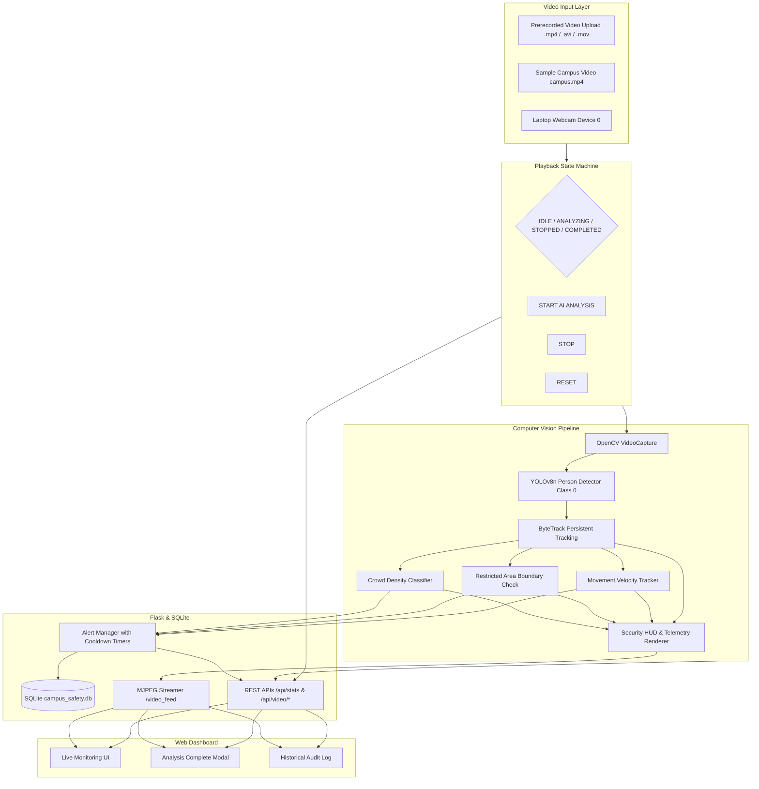

# AI Smart Campus Safety & Monitoring System


An autonomous, lightweight Computer Vision and Web-based Dashboard system designed for real-time safety monitoring on educational campuses. The application analyzes video feeds (prerecorded CCTV `.mp4`, `.avi`, `.mov` or laptop webcams) to track occupancy, detect restricted area intrusions, and flag rapid movement anomalies without biometric identification.

---

## Table of Contents
1. [Project Overview](#project-overview)
2. [Core AI & Computer Vision Modules](#core-ai--computer-vision-modules)
3. [Video Upload & On-Demand Analysis Workflow](#video-upload--on-demand-analysis-workflow)
4. [System Architecture](#system-architecture)
5. [Technology Stack](#technology-stack)
6. [Folder Structure](#folder-structure)
7. [Prerequisites & System Requirements](#prerequisites--system-requirements)
8. [Installation & Setup (Windows / Linux / macOS)](#installation--setup)
9. [Running the Application](#running-the-application)
10. [How to Use the System](#how-to-use-the-system)
    - [Uploading Custom Videos](#uploading-custom-videos)
    - [Using the Sample Campus Video](#using-the-sample-campus-video)
    - [Using Laptop Webcam](#using-laptop-webcam)
    - [Playback Controls (START, STOP, RESET)](#playback-controls)
    - [End-of-Video Analysis Summary Report](#end-of-video-analysis-summary-report)
11. [Detailed Module Explanations (For Viva / CSE Defense)](#detailed-module-explanations)
    - [Module 1: Anonymous Person Detection & Tracking](#module-1-anonymous-person-detection--tracking)
    - [Module 2: Crowd Counting & Density Classification](#module-2-crowd-counting--density-classification)
    - [Module 3: Restricted Area (ROI) Detection](#module-3-restricted-area-roi-detection)
    - [Module 4: Abnormal Movement Velocity Heuristic](#module-4-abnormal-movement-velocity-heuristic)
    - [Module 5: Centralized Alert Manager & Debounce Logic](#module-5-centralized-alert-manager--debounce-logic)
    - [Module 6: SQLite Persistence & Audit Log](#module-6-sqlite-persistence--audit-log)
12. [Configuration Reference (`config.py`)](#configuration-reference)
13. [Automated Testing Suite](#automated-testing-suite)
14. [Privacy & Ethical Statement](#privacy--ethical-statement)
15. [Troubleshooting Guide](#troubleshooting-guide)
16. [Viva Questions & Answers](#viva-questions--answers)

---

## Project Overview

The **AI Smart Campus Safety & Monitoring System** provides an explainable AI surveillance solution tailored for college and campus safety monitoring:

* **High Crowd Density Detection:** Real-time occupancy tracking with automatic categorization into `LOW`, `MEDIUM`, and `HIGH` density.
* **Restricted Area Perimeter Defense:** Configurable 2D ROI polygons to safeguard sensitive areas (e.g. Server Rooms, Chemistry Labs, High-Voltage Panels).
* **Unusual Rapid Movement Anomaly:** Explainable velocity heuristic requiring consecutive frames of high speed to flag running/sprinting events.
* **Anonymous AI Tracking:** Strict compliance with privacy standards — operates solely with anonymous integer IDs (`Person #1`, `Person #2`). No facial recognition.

---

## Video Upload & On-Demand Analysis Workflow

```
[ Step 1: Open Web Dashboard ] ──► http://127.0.0.1:5000/ (System in STANDBY)
            │
            ▼
[ Step 2: Choose Video File ] ──► Upload custom MP4/AVI/MOV OR click "Use Sample Campus Video"
            │
            ▼
[ Step 3: Click START AI ANALYSIS ] ──► Video streams frame-by-frame through YOLOv8n + OpenCV
            │
            ▼
[ Step 4: Live CCTV HUD Overlay ] ──► Real-time bounding boxes, track IDs, ROI hazard, speed trails
            │
            ▼
[ Step 5: Video Completion ] ──► Automatically presents "ANALYSIS COMPLETE" Summary Report:
                                  • Total Duration & Frames Processed
                                  • Peak People Detected
                                  • Maximum Crowd Level Reached
                                  • Breakdown of Logged Alerts
```

---

## System Architecture



---

## Technology Stack

* **Backend:** Python 3.10+ & Flask 3.1
* **AI / Deep Learning:** Ultralytics YOLOv8 nano (`yolov8n.pt`) with PyTorch CPU inference
* **Computer Vision:** OpenCV (`opencv-python`)
* **Multi-Object Tracking:** ByteTrack / Centroid Tracking
* **Database:** SQLite3 (WAL mode, parameterized queries)
* **Frontend:** HTML5, Vanilla CSS3 (Dark Security Command Center theme), JavaScript (Fetch & Polling)
* **Testing:** Pytest (20 automated unit & integration tests)

---

## Folder Structure

```
smart-campus-safety/
│
├── app.py                      # Flask main entrypoint & web routes
├── config.py                   # Centralized configuration & parameters
├── requirements.txt            # Python dependencies
├── generate_demo_video.py      # Self-contained campus demo video creator
├── verify_live_system.py       # Live HTTP/MJPEG health verification tool
├── README.md                   # Complete documentation & viva guide
│
├── detection/                  # Computer vision & safety modules
│   ├── __init__.py
│   ├── person_detector.py      # YOLOv8n detector with ByteTrack tracker
│   ├── crowd_analyzer.py       # Crowd density classifier (LOW/MED/HIGH)
│   ├── restricted_area.py      # ROI boundary collision & violation detector
│   ├── movement_analyzer.py    # Velocity tracker & consecutive-frame anomaly detector
│   ├── alert_manager.py        # Central debounce & cooldown alert dispatcher
│   └── video_stream.py         # Multi-threaded capture & MJPEG frame encoder
│
├── database/                   # SQLite data persistence
│   ├── __init__.py
│   └── db.py                   # Thread-safe SQLite helper & alert queries
│
├── static/                     # Frontend static assets
│   ├── css/
│   │   └── style.css           # Dark security command center styling
│   └── js/
│       ├── dashboard.js        # Video upload, analysis controls & telemetry
│       └── alerts.js           # Historical alert table & filtering
│
├── templates/                  # Jinja2 HTML templates
│   ├── dashboard.html          # Main live monitoring dashboard
│   └── alerts.html             # Historical alerts & audit log table
│
├── uploads/                    # Temporary storage for uploaded videos
│
├── videos/                     # Storage directory for sample videos
│   └── campus.mp4              # Default campus CCTV video
│
├── data/                       # Database storage directory
│   └── campus_safety.db        # SQLite database
│
└── tests/                      # Automated test suite (20 tests)
    ├── __init__.py
    ├── test_detector.py
    ├── test_crowd.py
    ├── test_restricted.py
    ├── test_movement.py
    ├── test_alert_manager.py
    ├── test_database.py
    └── test_api.py
```

---

## Installation & Setup

### Windows (PowerShell or Command Prompt)

```powershell
# 1. Navigate to the project directory
cd "c:\Users\Praveen kumar\Downloads\smart-campus-safety"

# 2. Create a Python Virtual Environment
python -m venv .venv

# 3. Activate the Virtual Environment
.\.venv\Scripts\activate

# 4. Install dependencies
pip install --upgrade pip
pip install -r requirements.txt
```

---

## Running the Application

```powershell
.\.venv\Scripts\python app.py
```

Open your browser and navigate to:
```
http://127.0.0.1:5000/
```

---

## How to Use the System

### 1. Uploading Custom Videos
1. Click **📁 Choose Video File** in the top bar.
2. Select any `.mp4`, `.avi`, or `.mov` file (up to 100MB).
3. The selected filename will appear on the dashboard.
4. Click **▶️ START AI ANALYSIS** to begin processing.

### 2. Using the Sample Campus Video
* Click **🎬 Use Sample Campus Video** to immediately load `videos/campus.mp4`.
* Click **▶️ START AI ANALYSIS**.

### 3. Playback Controls
* **▶️ START AI ANALYSIS:** Starts processing the video frame-by-frame from the beginning.
* **⏸️ STOP:** Pauses processing safely.
* **🔄 RESET:** Clears the current video/session, resets telemetry counters, and allows selecting another video.

### 4. End-of-Video Summary Report
When the video reaches the end:
* The system automatically freezes on the final frame with an `ANALYSIS COMPLETE` banner.
* A summary report modal displays:
  * **Frames Processed & Total Duration**
  * **Peak People Detected**
  * **Peak Crowd Density**
  * **Total Alerts Breakdown (Restricted Area, High Crowd, Movement)**

---

## Automated Testing Suite

Run all 20 automated unit and integration tests:

```powershell
.\.venv\Scripts\pytest tests/ -v
```

All 20 tests verify:
* YOLO Person detection and confidence scoring
* Multi-person counting and crowd levels (LOW, MEDIUM, HIGH)
* Restricted area ROI collision logic
* Movement velocity and consecutive frame requirements
* Cooldown debounce preventing duplicate alerts
* SQLite database CRUD and history clearing
* Video upload format validation and Start/Stop/Reset lifecycle

---

## Configuration Reference (`config.py`)

| Parameter | Default Value | Description |
|---|---|---|
| `MAX_UPLOAD_SIZE_MB` | `100` | Maximum upload file size in megabytes |
| `ALLOWED_EXTENSIONS` | `{'mp4', 'avi', 'mov'}` | Supported video container formats |
| `YOLO_MODEL_NAME` | `"yolov8n.pt"` | Ultralytics model file |
| `MODEL_CONFIDENCE_THRESHOLD` | `0.40` | Minimum detection confidence score |
| `FRAME_WIDTH` | `640` | Processing width |
| `FRAME_HEIGHT` | `360` | Processing height |
| `CROWD_LOW_MAX` | `5` | Maximum people for LOW level |
| `CROWD_MEDIUM_MAX` | `12` | Maximum people for MEDIUM level |
| `RESTRICTED_AREA_COORDS` | `[420, 40, 620, 240]` | Coordinates $[x_1, y_1, x_2, y_2]$ of restricted ROI |
| `RAPID_MOVEMENT_THRESHOLD` | `28.0` | Pixel displacement per frame for rapid movement |
| `CONSECUTIVE_FRAMES_REQUIRED` | `3` | Required consecutive frames of rapid movement |
| `ALERT_COOLDOWN_CROWD` | `20.0` | Seconds between high crowd alerts |
| `ALERT_COOLDOWN_RESTRICTED` | `15.0` | Seconds between restricted area alerts per person |
| `ALERT_COOLDOWN_MOVEMENT` | `15.0` | Seconds between movement alerts per person |

---

## Viva Questions & Answers (CSE Project Defense)

**Q1: How is the video processed by the AI instead of playing as a raw HTML video?**  
*Answer:* The browser receives an MJPEG stream generated by Flask (`/video_feed`). On the backend, OpenCV captures each individual frame from `cv2.VideoCapture()`, feeds it through the YOLOv8 neural network and tracking algorithms, draws HUD overlays (bounding boxes, ROI hazard polygons, telemetry), and encodes it as JPEG bytes.

**Q2: How does the system handle video uploads securely?**  
*Answer:* The backend validates file extensions against an allowlist (`.mp4`, `.avi`, `.mov`), enforces a 100MB limit (`MAX_CONTENT_LENGTH`), and sanitizes filenames using Werkzeug's `secure_filename()` to prevent directory traversal attacks.

**Q3: What happens when the video reaches the end?**  
*Answer:* The processing loop detects `ret == False`, sets `analysis_state = "COMPLETED"`, computes session statistics (max people, max crowd, alert counts), and sends a summary payload to the dashboard which displays the Analysis Complete dialog.

---

## Privacy & Ethical Statement

> **Privacy Notice:**
> This prototype complies with ethical AI guidelines:
> 1. **Zero Biometrics:** No facial recognition or facial embeddings are extracted or stored.
> 2. **Anonymous Tracking:** People are identified solely by temporary numeric IDs (`Person #1`, `Person #4`).
> 3. **Advisory Terminology:** Safety events are flagged with advisory terms (*"Potential Safety Alert"*, *"Unusual Rapid Movement"*).
